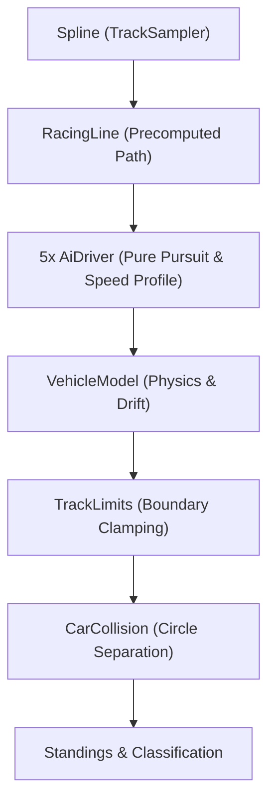

# AI Opponents and Race System

This document describes the autonomous racing system, pathfinding, driver behaviors, starting grid, standings, and classification implemented in Task 10.

---

## 1. Overview & Architecture

The AI and race rules operate purely in the deterministic simulation tier (`src/ai` and `src/race`). Under the architectural rules in `AGENTS.md`:

- Simulation code imports **only** from `core` and `data`.
- Simulation code **never imports Three.js** or presentation models.
- All simulation systems execute at a **fixed 60 Hz** timestep with zero allocations per frame.
- AI vehicles use the exact same `VehicleModel` physics, `TrackLimits`, and friction mechanics as the player — they never cheat on grip or acceleration.

---

## 2. Precomputed Racing Line (`RacingLine.ts`)

The racing line is built once per track load from a `TrackSampler` (implemented by `Spline`).

### 2.1 Sampling & Equidistant Discretization

- The spline is sampled at approximately equidistant intervals of $\approx 4.5\,\text{m}$ along the total length.
- At each sample point $i$, the centerline position $\vec{P}_i$, unit tangent $\vec{T}_i$, and road width $W_i$ are extracted.

### 2.2 Curvature & Apex Offset Generation

- Tangent orientation angle $\theta_i = \text{atan2}(T_{z,i}, T_{x,i})$ is computed.
- Curvature $\kappa_i = |\Delta\theta| / \Delta s$.
- To seek apexes on corners, an offset vector points toward the inside of the upcoming turn:
  $$\text{lateralOffset}_i = \text{clamp}(-\Delta\theta \times k_{\text{apex}}, -W_{\text{safe}}, +W_{\text{safe}})$$
  where $W_{\text{safe}} = 0.5 \cdot W_i - \text{ROAD\_SAFETY\_MARGIN}$ ($2.2\,\text{m}$ inside track boundary).
- Sample 3D world position is offset along the local track normal vector:
  $$\vec{P}_{\text{line}, i} = \vec{P}_i + \vec{N}_i \cdot \text{lateralOffset}_i$$

### 2.3 Speed Profiling (Backward & Forward Passes)

1. **Corner Speed Capping:** The initial target speed at each point is capped by lateral acceleration limits ($a_{\text{lat, max}} \approx 13.5\,\text{m/s}^2$):
   $$v_{\text{corner}} = \sqrt{\frac{a_{\text{lat, max}}}{\max(\kappa, 0.001)}}$$
   clamped between minimum corner speed ($16.0\,\text{m/s}$) and top speed fraction.
2. **Backward Deceleration Pass:** Propagates braking requirements backwards along the track so cars brake _before_ entering corners:
   $$v_{i} = \min\left(v_{i}, \sqrt{v_{i+1}^2 + 2 \cdot a_{\text{brake}} \cdot \Delta s}\right)$$
   where $a_{\text{brake}} \approx 14.0\,\text{m/s}^2$. Runs two cyclic iterations for seamless wrap across the finish line.
3. **Forward Acceleration Pass:** Limits acceleration out of corners based on physical vehicle drive limits ($a_{\text{accel}} \approx 9.5\,\text{m/s}^2$):
   $$v_{i+1} = \min\left(v_{i+1}, \sqrt{v_{i}^2 + 2 \cdot a_{\text{accel}} \cdot \Delta s}\right)$$

---

## 3. Autonomous Driver (`AiDriver.ts`)

Each opponent runs an `AiDriver` instance maintaining internal progress via a windowed local search ($O(1)$ amortized):

### 3.1 Pure Pursuit Steering

- Dynamic lookahead distance scales with current vehicle speed:
  $$d_{\text{lookahead}} = \text{clamp}(d_{\text{base}} + v \cdot t_{\text{gain}}, 8.0\,\text{m}, 34.0\,\text{m})$$
- The car evaluates the lateral displacement $x_{\text{local}}$ to the lookahead point in vehicle local coordinates.
- Steering output:
  $$\text{steer} = \text{clamp}\left(\frac{x_{\text{local}}}{\max(4.0, d_{\text{lookahead}})} \cdot k_{\text{steer}}, -1.0, 1.0\right)$$

### 3.2 Predictive Throttle & Braking

- Compares current speed $v$ against upcoming target speed $v_{\text{target}}$ at distance $d_{\text{target}}$.
- Required braking distance is estimated by:
  $$d_{\text{brake}} = \frac{v^2 - v_{\text{target}}^2}{2 \cdot a_{\text{decel}}}$$
- If $d_{\text{target}} \le d_{\text{brake}}$, throttle is cut to zero and brake is applied proportionally.
- There is **never** simultaneous full throttle and brake input.

### 3.3 Driver Jitter & Personality

Each opponent roster driver has unique parameters:

- `skill`: Speed scalar ($0.90$ to $0.98$).
- `lineBias`: Lateral preference ($-0.25\,\text{m}$ to $+0.30\,\text{m}$).
- Jitter is sampled at $\approx 1\,\text{Hz}$ using seeded Mulberry32 PRNG and smoothly blended:
  - Target speed jitter: $\pm 1.5\%$
  - Lateral offset jitter: $\pm 0.6\,\text{m}$
  - Braking point scale: $0.95$ to $1.05$

### 3.4 Rubber-Banding Rule (`RubberBanding.ts`)

Rubber-banding is a smooth, continuous function of the longitudinal gap $\Delta s$ between the AI car and the player:

- If AI is **ahead** ($\Delta s > 0$), AI speed target decreases smoothly down to $0.92\times$ ($-8\%$).
- If AI is **behind** ($\Delta s < 0$), AI speed target increases smoothly up to $1.08\times$ ($+8\%$).
- Transition occurs smoothly across a $150\,\text{m}$ window:
  $$t = \text{clamp}\left(\frac{-\Delta s}{150\,\text{m}}, -1.0, 1.0\right)$$
  $$\text{scale} = 1.0 + 0.08 \cdot \left(3t^2 - 2t^3\right) \cdot \text{strength}$$

### 3.5 Standstill Recovery

- If an AI car is stalled ($\text{speed} < 3.0\,\text{m/s}$) for more than $3.0\,\text{seconds}$ during race active phase, it triggers deterministic respawn $6.0\,\text{m}$ ahead on the racing line facing the forward tangent at $8.0\,\text{m/s}$.

---

## 4. Race Rules & Grid (`src/race/`)

### 4.1 Starting Grid (`GridLayout.ts`)

- 6 slots arranged in a 2-column staggered formation placed **ahead** of the start line.
- Slot 0 (Pole): $24\,\text{m}$ ahead of start line, left lane ($-3.0\,\text{m}$ offset).
- Slot 5 (Player): $8\,\text{m}$ ahead of start line, right lane ($+3.0\,\text{m}$ offset).
- The player starts in 6th position (last place) ahead of the start line, well before Checkpoint 1 ($154.8\,\text{m}$).

### 4.2 Car-to-Car Soft Collisions (`CarCollision.ts`)

- Circular bounding volume with radius $R = 1.1\,\text{m}$ (diameter $2.2\,\text{m}$).
- When overlap $\delta = 2.2 - d > 0$:
  - Positional separation of $0.5 \cdot \delta$ along contact normal $\vec{n}$.
  - The trailing vehicle (hitting from behind) receives a bounded speed penalty (up to $15\%$ deceleration, capped at $3.0\,\text{m/s}$).
  - Speeds never drop below $2.0\,\text{m/s}$ to prevent cars from trapping one another.

### 4.3 Standings & Race Classification

- `Standings`: Tracks unwrapped cumulative race progress in meters. Crossing the finish line does not cause drops in reported position.
- Finished racers are ordered strictly by finish step.
- `Classification`: Formats total finish time for the winner, time gaps ($+\Delta t\,\text{s}$) for finished runners-up, and distance gaps ($+\Delta d\,\text{m}$) for cars still running.
- Highlighted row for player entry.

---

## 5. Dev Tools & Tuning

- **Debug Overlay (`` ` `` key):** Displays real-time 60 Hz simulation step execution time (`Sim: X.XX ms`). Mid-range target budget is under $2.0\,\text{ms}$.
- **Tuning Panel (`F2` key):** Live sliders for:
  - **AI Pace Scale:** range $0.80\times$ to $1.10\times$ (default $1.00\times$).
  - **Rubber-band Strength:** range $0.00$ to $1.00$ (default $1.00$).
